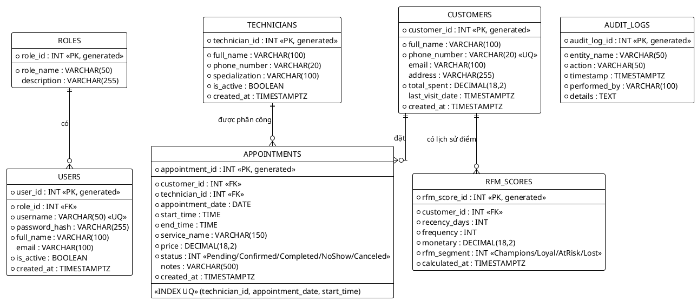

# TÀI LIỆU THIẾT KẾ KIẾN TRÚC HỆ THỐNG SALONCARE CRM (W02/W03)

**Đồ án:** Hệ thống CRM quản lý Spa/Salon nhỏ giảm tỉ lệ bỏ hẹn (No-show) dựa trên phân khúc RFM  
**Sinh viên thực hiện:** Hoàng Khắc Trung Hiếu | **MSSV:** 2380600645 | **Lớp:** 23DTHC7  
**Giảng viên hướng dẫn:** TS. Nguyễn Quang Trung  
**Mã nguồn tham chiếu:** .NET 8.0 / C# / PostgreSQL 16 / EF Core 8.0  

---

## 1. SƠ ĐỒ C4 MỨC 1: BỐI CẢNH HỆ THỐNG (SYSTEM CONTEXT DIAGRAM)

Sơ đồ System Context mô tả ranh giới hệ thống SalonCare CRM, tương tác giữa các tác nhân (Actors) chính bao gồm Chủ Salon, Lễ tân, Khách hàng cùng các hệ thống bên ngoài (External Services: Zalo OA API / ZNS).

```plantuml
@startuml C4_Elements
!include https://raw.githubusercontent.com/plantuml-stdlib/C4-PlantUML/master/C4_Context.puml

LAYOUT_WITH_LEGEND()

title Sơ đồ C4 Mức 1: System Context - Hệ thống SalonCare CRM

Person(owner, "Chủ Salon (Salon Owner)", "Giám sát hiệu quả hoạt động kinh doanh, xem thống kê tỷ lệ No-show, báo cáo phân khúc khách hàng RFM và quản trị cấu hình dịch vụ.")
Person(receptionist, "Lễ tân (Receptionist)", "Tiếp nhận khách hàng, xếp lịch hẹn trên hệ thống, xử lý cảnh báo trùng lịch KTV, check-in và ghi nhận trạng thái No-show.")
Person(customer, "Khách hàng (Customer)", "Đặt lịch hẹn dịch vụ Spa/Salon, nhận thông báo ZNS nhắc hẹn qua Zalo và phản hồi xác nhận/hủy hẹn trực tiếp.")

System(saloncare, "Hệ thống SalonCare CRM", "Hệ thống quản lý salon tập trung, thực thi thuật toán kiểm tra trùng lịch KTV, tính toán phân khúc RFM và điều phối kịch bản gửi tin Zalo tự động.")

System_Ext(zaloOA, "Zalo Cloud & Official Account (ZNS)", "Nền tảng gửi tin nhắn thông báo chăm sóc khách hàng ZNS theo mẫu đã duyệt và bắn Webhook phản hồi hai chiều về SalonCare.")
System_Ext(smsProvider, "SMS Brandname Provider (Backup)", "Kênh gửi tin nhắn SMS thương hiệu dự phòng khi khách hàng không có tài khoản Zalo.")

Rel(owner, saloncare, "Quản trị, xem báo cáo RFM, cấu hình hệ thống", "HTTPS / Desktop Browser")
Rel(receptionist, saloncare, "Xếp lịch hẹn, kiểm tra trùng giờ KTV, check-in khách", "HTTPS / Web Browser")
Rel(customer, zaloOA, "Đọc tin nhắn ZNS nhắc hẹn, bấm nút Xác nhận/Đổi lịch", "Zalo Mobile App")

Rel(saloncare, zaloOA, "Gửi lệnh bắn tin ZNS nhắc lịch hẹn (T-24h, T-2h) & mã OTP", "HTTPS / JSON REST API")
Rel(zaloOA, saloncare, "Gửi sự kiện Webhook phản hồi từ khách hàng (Confirmed/Canceled)", "HTTPS / Webhook Callback")
Rel(saloncare, smsProvider, "Kích hoạt gửi SMS dự phòng nếu ZNS thất bại", "HTTPS / REST API")

@enduml
```

---

## 2. SƠ ĐỒ C4 MỨC 2: CẤU TRÚC CONTAINER (CONTAINER DIAGRAM)

Sơ đồ Container phân rã hệ thống SalonCare CRM thành các khối thực thi (Containers), quy định rõ vai trò kỹ thuật, công nghệ sử dụng và giao thức truyền tải giữa các thành phần.

```plantuml
@startuml C4_Container
!include https://raw.githubusercontent.com/plantuml-stdlib/C4-PlantUML/master/C4_Container.puml

LAYOUT_WITH_LEGEND()

title Sơ đồ C4 Mức 2: Container Diagram - SalonCare CRM Architecture

Person(receptionist, "Lễ tân / Nhân viên", "Điều phối và thao tác đặt lịch")
Person(customer, "Khách hàng Spa/Salon", "Tương tác xác nhận lịch hẹn")

System_Boundary(c1, "Ranh giới Hệ thống SalonCare CRM") {
    Container(web_ui, "Web App UI (Razor Views)", "ASP.NET Core 8.0 Razor, Bootstrap 5, Bootstrap Icons, JavaScript", "Hiển thị giao diện đặt lịch, bảng theo dõi lịch KTV, dashboard KPI và cảnh báo trùng lịch thời gian thực.")
    Container(web_backend, "Web API & Backend Services", "ASP.NET Core 8.0 MVC / C# (.NET 8)", "Xử lý Controller, Model Binding, Logic nghiệp vụ IAppointmentService, IRfmService, xác thực và bảo mật.")
    ContainerDb(database, "Relational Database", "PostgreSQL 16", "Lưu trữ toàn bộ thực thể Customers, Technicians, Appointments, RfmScores, AuditLogs. Đảm bảo toàn vẹn dữ liệu với Unique Index chống trùng lịch.")
    Container(worker_service, "Background Worker (Cron Service)", "Quartz.NET / .NET 8 BackgroundService", "Thực thi tác vụ chạy ngầm định kỳ: quét lịch hẹn sắp đến hạn gửi ZNS, quét khách hàng không ghé thăm > 60 ngày để chấm điểm RFM.")
}

System_Ext(zalo_service, "Zalo OA / ZNS Service", "Zalo Cloud Platform", "Hạ tầng gửi tin nhắn ZNS định dạng mẫu và cơ chế Webhook hai chiều.")

Rel(receptionist, web_ui, "Thao tác xếp lịch, tra cứu KTV", "HTTPS")
Rel(web_ui, web_backend, "Truyền dữ liệu Form POST, HTTP Request", "HTTPS / Form & JSON")
Rel(web_backend, database, "Truy vấn, ghi dữ liệu, kiểm tra Overlap (EF Core 8)", "TCP / SQL (Port 5432)")
Rel(worker_service, database, "Quét lịch hẹn cần nhắc, cập nhật RfmScores", "TCP / SQL (Port 5432)")
Rel(worker_service, zalo_service, "Gửi tin nhắn ZNS nhắc hẹn tự động", "HTTPS / REST API (JSON)")
Rel(zalo_service, customer, "Chuyển phát thông báo ZNS đến điện thoại", "Zalo Protocol / Mobile App")
Rel(customer, zalo_service, "Bấm nút [Xác nhận lịch hẹn] / [Hủy]", "Zalo Mobile App")
Rel(zalo_service, web_backend, "Bắn Webhook cập nhật trạng thái lịch hẹn", "HTTPS / JSON Webhook")

@enduml
```

---

## 3. ARCHITECTURE DECISION RECORDS (ADR) CHUẨN MICHAEL NYGARD

### ADR-01: Lựa chọn PostgreSQL 16 làm Cơ sở dữ liệu Quan hệ & Xử lý tương tranh
- **Trạng thái:** Đã chấp thuận (Accepted).
- **Người đề xuất:** Hoàng Khắc Trung Hiếu (Technical Lead).
- **Ngày phê duyệt:** Tuần 03 / Học kỳ 1 2026.

#### Bối cảnh (Context)
Nghiệp vụ cốt lõi của SalonCare là điều phối lịch hẹn dịch vụ làm đẹp giữa Khách hàng và Kỹ thuật viên (Thợ). Mỗi kỹ thuật viên chỉ có thể phục vụ 1 khách hàng tại một thời điểm nhất định. Khi nhiều lễ tân hoặc khách hàng cùng thao tác đặt lịch đồng thời (Race Condition), hệ thống bắt buộc phải đảm bảo tính toàn vẹn (ACID), ngăn chặn triệt để tình trạng Double Booking (hai lịch hẹn trùng giờ cho cùng một thợ). Đồng thời, hệ thống cần tính toán số liệu tài chính, doanh thu và điểm tích lũy theo phân khúc RFM.

#### Các phương án cân nhắc (Considered Options)
1. **Phương án 1: PostgreSQL 16 (Relational Database)**:
   - Ưu điểm: Hỗ trợ chuẩn ACID trọn vẹn; hỗ trợ ràng buộc toàn vẹn khóa ngoại (Foreign Keys); hỗ trợ Unique Composite Index đa cột `(technician_id, appointment_date, start_time)` ở cấp CSDL; hỗ trợ kiểu dữ liệu ngày giờ mới `date`, `time` ánh xạ hoàn hảo với `DateOnly`, `TimeOnly` của .NET 8; tính năng Transaction Isolation Levels (Read Committed, Serializable) chống Race Condition. Hỗ trợ thêm kiểu `JSONB` cho Audit Log linh hoạt.
   - Nhược điểm: Cần quản lý lược đồ dữ liệu (Migrations) nghiêm ngặt hơn cơ sở dữ liệu Document.
2. **Phương án 2: MongoDB (NoSQL Document Store)**:
   - Ưu điểm: Lược đồ dữ liệu linh hoạt (Schema-less), tốc độ ghi tài liệu đơn lẻ nhanh.
   - Nhược điểm: Khó khăn và tốn chi phí kiểm soát ràng buộc toàn vẹn khi kiểm tra khoảng thời gian giao thoa `[StartTime, EndTime)` của cùng một KTV. Khả năng quản lý ACID đa bảng phức tạp, dễ dẫn đến hiện tượng trùng lịch khi có độ trễ đồng bộ (Eventual Consistency).

#### Quyết định (Decision)
**Lựa chọn PostgreSQL 16** làm hệ quản trị cơ sở dữ liệu chính cho toàn bộ hệ thống SalonCare CRM. Kết hợp cùng Entity Framework Core 8.0 và Npgsql Provider. Tạo Unique Index `(TechnicianId, AppointmentDate, StartTime)` trực tiếp tại CSDL để tạo "lá chắn thép" tầng thấp nhất ngăn chặn race condition.

#### Hệ quả (Consequences)
- **Tích cực:** Đảm bảo 100% không thể xảy ra hiện tượng xếp trùng giờ KTV ở cấp độ cơ sở dữ liệu; mô hình quan hệ chặt chẽ giữa Khách hàng, Thợ, Lịch hẹn và Điểm RFM; hỗ trợ kiểm thử tích hợp (Integration Test) ổn định.
- **Tiêu cực / Rủi ro:** Cần đảm bảo môi trường triển khai có sẵn PostgreSQL instance (được bù đắp bằng cơ chế Auto Migration và In-Memory fallback khi khởi chạy thử nghiệm).

---

### ADR-02: Lựa chọn ASP.NET Core 8.0 MVC làm Nền tảng Backend Framework
- **Trạng thái:** Đã chấp thuận (Accepted).
- **Người đề xuất:** Hoàng Khắc Trung Hiếu (Technical Lead).
- **Ngày phê duyệt:** Tuần 03 / Học kỳ 1 2026.

#### Bối cảnh (Context)
Dự án yêu cầu xây dựng hệ thống phần mềm quản trị ổn định, bảo mật cao, mã nguồn được module hóa rõ ràng theo chuẩn công nghiệp (Layered Architecture: Core, Infrastructure, Web, Tests), cho phép mở rộng lâu dài thành đồ án tốt nghiệp. Đội ngũ phát triển cần khả năng phát hiện lỗi kiểu dữ liệu ngay tại thời điểm biên dịch (Compile-time Safety) và bộ công cụ kiểm thử tự động toàn diện.

#### Các phương án cân nhắc (Considered Options)
1. **Phương án 1: ASP.NET Core 8.0 (C# / LTS)**:
   - Ưu điểm: Hiệu năng đỉnh cao (top đầu bảng xếp hạng TechEmpower Benchmarks); kiến trúc Dependency Injection (DI) tích hợp sẵn; hệ thống bảo mật chống CSRF (`[ValidateAntiForgeryToken]`), XSS tự động; ORM Entity Framework Core 8 hiện đại; hỗ trợ xUnit/Moq kiểm thử trực quan; Razor Views tích hợp đóng gói trọn gói giao diện và controller mà không cần dựng riêng Single Page App phức tạp ở giai đoạn W02/W03.
   - Nhược điểm: Bộ nhớ khởi tạo ban đầu có thể nhỉnh hơn các micro-framework tối giản.
2. **Phương án 2: Node.js với Express.js**:
   - Ưu điểm: Hệ sinh thái JavaScript phổ biến, khởi tạo dự án nhanh.
   - Nhược điểm: Thiếu cơ chế kiểm soát kiểu tĩnh chặt chẽ (nếu không cấu hình TypeScript phức tạp); thiếu kiến trúc chuẩn mực (mỗi lập trình viên viết một kiểu); phải cài đặt hàng chục thư viện bên ngoài (ORM Prisma/TypeORM, validation, DI container, test framework) thiếu sự đồng nhất; rủi ro callback/promise unhandled.

#### Quyết định (Decision)
**Lựa chọn ASP.NET Core 8.0 (C#)** làm nền tảng Backend Framework chủ lực, triển khai theo kiến trúc Phân tầng (Layered Architecture):
- `SalonCare.Core`: Domain Entities, Business Rules, Interfaces, Enums.
- `SalonCare.Infrastructure`: EF Core DbContext, Repositories, Database Configurations.
- `SalonCare.Web`: Controllers, ViewModels, Razor Views, Bootstrap 5 UI.
- `SalonCare.Tests`: xUnit, Moq, FluentAssertions.

#### Hệ quả (Consequences)
- **Tích cực:** Mã nguồn sạch sẽ (Clean Code), phân định rõ ràng trách nhiệm (Separation of Concerns); bảo trì thuận tiện; dễ dàng viết Unit Test với độ bao phủ cao; sẵn sàng mở rộng REST API cho Mobile App trong các giai đoạn sau.
- **Tiêu cực:** Đòi hỏi lập trình viên nắm vững kiến trúc C# .NET và tư duy hướng đối tượng OOP.

---

### ADR-03: Lựa chọn Zalo Official Account (ZNS) làm Kênh Nhắc lịch & Giảm No-show
- **Trạng thái:** Đã chấp thuận (Accepted).
- **Người đề xuất:** Hoàng Khắc Trung Hiếu (Technical Lead).
- **Ngày phê duyệt:** Tuần 03 / Học kỳ 1 2026.

#### Bối cảnh (Context)
Vấn đề nhức nhối nhất của các cơ sở Spa/Salon vừa và nhỏ tại Việt Nam là tỷ lệ khách hàng bỏ hẹn không báo trước (No-show Rate) dao động từ 15% đến 30%, gây thiệt hại doanh thu và lãng phí thời gian trống của kỹ thuật viên. Do đó, kênh tiếp cận và nhắc lịch bắt buộc phải có tỷ lệ đọc tin cao, chi phí tiết kiệm, khách hàng có thể tương tác hai chiều để phản hồi "Đến đúng giờ" hoặc "Xin đổi lịch hẹn".

#### Các phương án cân nhắc (Considered Options)
1. **Phương án 1: Zalo Notification Service (ZNS) qua Zalo OA**:
   - Ưu điểm: Hơn 75 triệu người dùng thường xuyên tại Việt Nam; tỷ lệ mở tin nhắn thực tế đạt trên 85% trong 15 phút đầu; hỗ trợ nút bấm tương tác CTA (Call-to-Action) phản hồi 2 chiều qua Webhook; chi phí tối ưu (khoảng 150 - 250 VNĐ/tin, rẻ hơn 60% so với SMS Brandname); định dạng tin nhắn đẹp mắt, chuyên nghiệp.
   - Nhược điểm: Doanh nghiệp cần xác thực Zalo Official Account và đăng ký Template tin nhắn trước với ban kiểm duyệt Zalo.
2. **Phương án 2: SMS Brandname (Tin nhắn thương hiệu viễn thông)**:
   - Ưu điểm: Gửi được đến mọi điện thoại di động kể cả không có kết nối Internet.
   - Nhược điểm: Chi phí đắt đỏ (500 - 800 VNĐ/tin); chỉ gửi được văn bản 1 chiều không dấu, khách hàng không thể bấm nút tương tác xác nhận lịch hẹn tức thời; tỷ lệ bị đưa vào hộp thư rác (Spam) cao.
3. **Phương án 3: Email Marketing**:
   - Ưu điểm: Miễn phí hoặc chi phí rất thấp.
   - Nhược điểm: Tỷ lệ mở tin cực kỳ thấp đối với dịch vụ làm đẹp đại chúng (< 15%); khách hàng hiếm khi kiểm tra email hàng ngày trước giờ hẹn làm tóc/spa.

#### Quyết định (Decision)
**Lựa chọn Zalo Notification Service (ZNS)** làm kênh liên lạc tự động chủ đạo để nhắc hẹn (T-24h và T-2h) và gửi ưu đãi giữ chân khách hàng nhóm `AtRisk` (Nguy cơ rời bỏ > 60 ngày). Duy trì SMS Brandname làm kênh dự phòng cấp 2.

#### Hệ quả (Consequences)
- **Tích cực:** Giảm thiểu tỷ lệ No-show xuống dưới 5% nhờ cơ chế nhắc hẹn trực tiếp và nút bấm tương tác 2 chiều; tối ưu hóa chi phí vận hành cho chủ cơ sở Spa/Salon.
- **Tiêu cực:** Cần phát triển module xử lý Webhook bất đồng bộ an toàn và cơ chế xác thực Token định kỳ từ Zalo OpenAPI.

---

## 4. SƠ ĐỒ THỰC THỂ LIÊN KẾT (ENTITY RELATIONSHIP DIAGRAM - ERD)

### 4.1. Mã PlantUML ERD


### 4.2. Bảng Mô tả Quan hệ Thực thể (ASCII Schema Summary)

```
==================================================================================================
BẢNG              KHÓA CHÍNH (PK)      KHÓA NGOẠI (FK)          RÀNG BUỘC ĐẶC BIỆT / INDEX
==================================================================================================
ROLES             role_id              -                        UQ(role_name)
USERS             user_id              role_id -> ROLES         UQ(username)
CUSTOMERS         customer_id          -                        UQ(phone_number)
TECHNICIANS       technician_id        -                        Index(is_active)
APPOINTMENTS      appointment_id       customer_id -> CUSTOMERS UQ_INDEX(technician_id,
                                       technician_id -> TECHS            appointment_date, start_time)
RFM_SCORES        rfm_score_id         customer_id -> CUSTOMERS Index(customer_id, calculated_at)
AUDIT_LOGS        audit_log_id         -                        Index(timestamp, entity_name)
==================================================================================================
```
